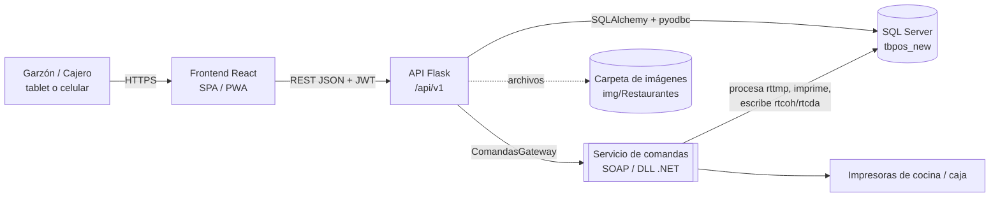
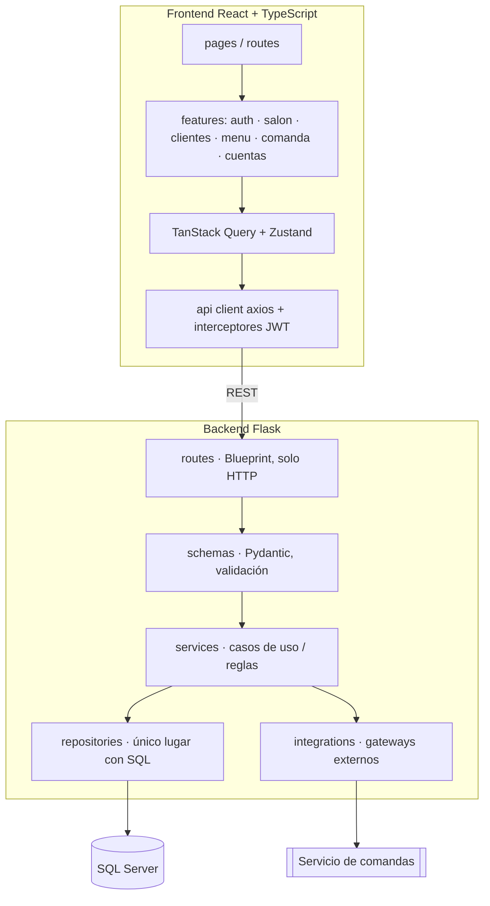
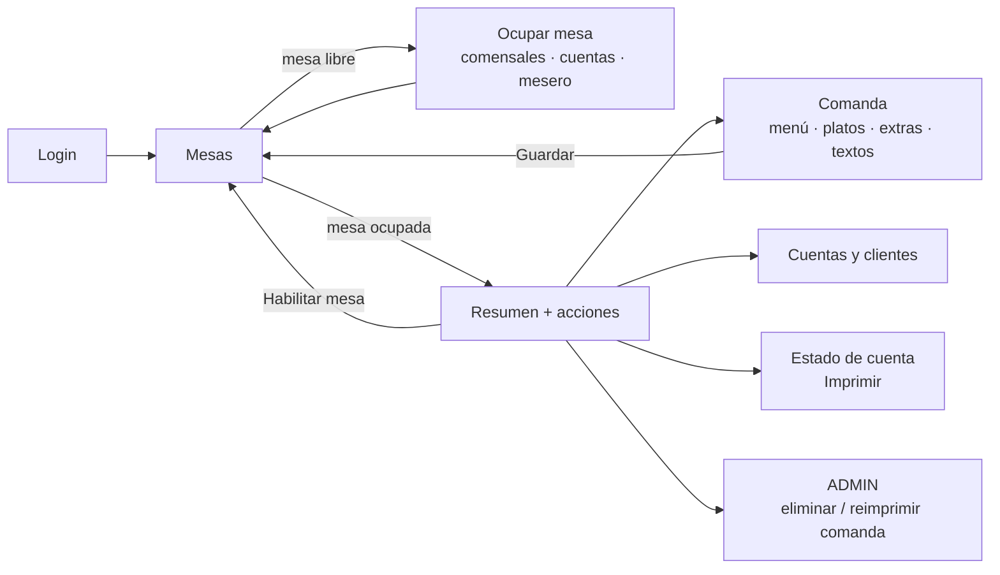
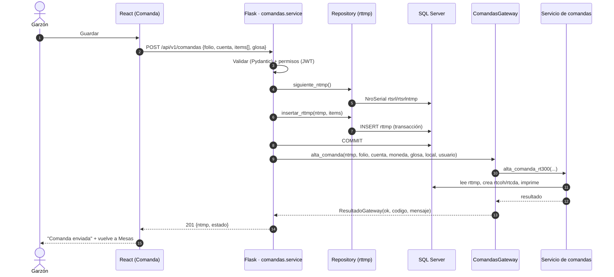

# RT-300 · Nuevo sistema (Flask + React) — Arquitectura general

> Documento para presentar al equipo. Los diagramas están en Mermaid (se ven en GitHub, GitLab, VS Code con extensión Mermaid, y en la versión publicada como página).
> Documentos relacionados: [01-backend-flask.md](01-backend-flask.md) · [02-frontend-react.md](02-frontend-react.md) · [03-puesta-en-marcha.md](03-puesta-en-marcha.md)

---

## 1. Objetivo

Reescribir el módulo **RT-300 (pedidos de restaurante)** del sistema PHP actual con una arquitectura **limpia y escalable**, conservando:

| Se conserva | Se mejora |
|---|---|
| **La base de datos `tbpos_new` tal cual** (no se altera esquema ni datos existentes) | Seguridad: consultas parametrizadas, JWT, permisos por rol, sin `sys_func` dinámico |
| **La lógica de negocio** (ocupar mesa, tomar comanda, estado de cuenta) | Mantenibilidad: capas, módulos por dominio, pruebas |
| **El contrato con el servicio externo de comandas** (SOAP / DLL) | Integración aislada detrás de una interfaz intercambiable |
| Los flujos que ya conocen los garzones | UI moderna, táctil, modo claro/oscuro |

**Regla de oro:** *la BD se respeta.* Los nombres crípticos (`rtfoc`, `adusrclav`…) quedan encapsulados en la capa de repositorios; la API y el frontend hablan en términos de negocio (`Cuenta`, `Mesa`, `Comanda`).

---

## 2. Vista del sistema (contexto)

Puntos clave:
- El **servicio de comandas** sigue siendo quien procesa e imprime; el backend nuevo solo lo invoca (igual que hoy PHP).
- El backend nunca expone SQL ni nombres de tabla al frontend.
- Las imágenes de platos se leen por nombre desde `rtalb.rtalbnimg`.

---

## 3. Arquitectura por capas

**Dependencias permitidas (de arriba hacia abajo, nunca al revés):**
`routes → services → repositories / integrations`. Un `service` no conoce Flask; un `repository` no conoce reglas de negocio.

---

## 4. Dominios (módulos)

Cada dominio es un paquete independiente en el backend (`app/modules/<dominio>`) y una carpeta de funcionalidad en el frontend (`src/features/<dominio>`). Agregar una función nueva = agregar un dominio, sin tocar los demás.

| Dominio | Pantalla | Tablas legacy principales | Equivale a (PHP) |
|---|---|---|---|
| **auth** | Login | `adusr`, `rturt`, `vtcre`, `vtloc` | `index.php` |
| **salon** | Mesas | `rtmsa`, `rtaco`, `rtfol`, `rtfoc`, `gbven` | `RT300a` |
| **clientes** | Cuentas y clientes | `gbage`, `rtfoc` | `RT300b` |
| **menu** | (catálogo, usado por Comanda) | `rtsme`, `rtssm`, `rtalb`, `rtins`, `rtial`, `rttxt`, `rtcpd`, `inart`, `inpva` | `RT300c` (carga) |
| **comandas** | Comanda / Admin comandas | `rttmp`, `rtcoh`, `rtcda`, `rtmtr`, `rtsrl` | `RT300c` (guardar), `RT300a` (eliminar/reimprimir) |
| **cuentas** | Estado de cuenta | `rtcoh`, `rtcda`, `gbpmt`, `gbrne`, `ddcon` | `RT303` |

Ideas futuras (ejemplos de módulos nuevos sin impacto en los existentes): reservas, pantalla de cocina en tiempo real, reportes de ventas, propinas, inventario de insumos.

---

## 5. Flujo funcional de punta a punta

---

## 6. Flujo crítico: guardar una comanda

Este es el flujo más delicado y el que define el diseño del gateway. El sistema actual lo hace así (se mantiene la lógica):

1. El navegador envía la comanda completa (platos, textos, centros de producción, insumos).
2. El servidor obtiene un número de transacción `ntmp` (`NroSerial` sobre `rtsrl.rtsrlntmp`).
3. Inserta **filas en `rttmp`** (tabla de paso) con `rttmpntra = ntmp` y un `rttmptipo` por clase de dato.
4. Hace `COMMIT`.
5. Invoca al servicio externo `alta_comanda_rt300(ntra, nfol, ncta, cmon, glos, cloc, usrn, pass)`.
6. El servicio lee `rttmp`, genera la comanda real (`rtcoh/rtcda`), imprime en cocina y responde un resultado.

### Mejora propuesta (sin cambiar la lógica)
Hoy, si el servicio falla **después** del `COMMIT`, las filas de `rttmp` quedan huérfanas. En el nuevo sistema:
- Se registra el resultado del gateway y se devuelve un error claro (`GATEWAY_UNAVAILABLE`) al cliente.
- Se puede **reintentar** la invocación con el mismo `ntmp` (idempotente) sin volver a insertar `rttmp`.
- Con `FakeGateway` el flujo completo se puede probar sin el servicio real.

### Otras operaciones que usan el servicio externo

| Operación | Método del servicio | Parámetros |
|---|---|---|
| Guardar comanda | `alta_comanda_rt300` | `ntra, nfol, ncta, cmon, glos, cloc, usrn, pass` |
| Eliminar comanda | `eliminar_comanda_rt300` | `ntra, nfol, mesa, uaut, cont, mtvo, usrn, pass` |
| Reimprimir comanda | `Reimprimir_comanda_rt300` | `ntra, nfol, mesa, uaut, mtvo, usrn, pass` |
| Imprimir estado de cuenta | `stdo_cuenta_rt303` | `nfol, ncta, tped, mesa, cven, caco, calm, cloc, usrn, pass` (éxito = `100`) |

---

## 7. Seguridad (resumen)

| Problema actual | Solución |
|---|---|
| SQL concatenado → inyección | Consultas parametrizadas en repositories |
| `sys_func` ejecuta cualquier función | Rutas REST explícitas, una por acción |
| Sesión PHP con clave guardada | JWT de corta duración (+ refresh). **La clave no se guarda** |
| Hash de clave débil (`clave_calcular`) | Se mantiene solo para *verificar* contra `adusr`; migración gradual a hash fuerte en tabla nueva |
| Archivos expuestos (`phpinfo`, `*.bak`) | Backend solo expone `/api/v1/*`; estáticos separados |
| Errores con detalle de ODBC al usuario | Handler global: log interno + mensaje genérico con `request_id` |

---

## 8. Decisiones y puntos abiertos

| # | Tema | Estado |
|---|---|---|
| 1 | **Forma del servicio de comandas**: hoy es un `.asmx` (SOAP/WSDL). Se mencionó que será una **DLL**. Si es .NET, Python no la carga directamente: opciones en [01-backend-flask.md §7](01-backend-flask.md). El gateway permite cambiar sin tocar el negocio. | **Abierto — confirmar tipo de DLL** (.NET Framework / .NET, 32/64 bits) |
| 2 | **Credenciales hacia el servicio**: hoy se envía `usrn` + `pass` del garzón. Con JWT la clave no debe guardarse. ¿El servicio valida la clave o solo el usuario? | **Abierto** |
| 3 | Imágenes de platos: ruta real de producción de `img/Restaurantes` | Abierto |
| 4 | Entorno de despliegue (¿Windows + IIS o Linux/Docker?). Condiciona el uso de DLL .NET | Abierto |
| 5 | Roles/permisos: mapear `rturt` y niveles de `adusr` a roles | Por analizar |

---

## 9. Hoja de ruta propuesta

| Fase | Entregable | Riesgo |
|---|---|---|
| 0 | Repos, Docker, CI, esqueleto back y front, tema claro/oscuro | Bajo |
| 1 | **Solo lectura**: Login, Mesas, Menú (con imágenes y placeholder) | Bajo |
| 2 | Ocupar/habilitar mesa, Cuentas y clientes | Medio (escribe en BD) |
| 3 | Comanda completa con `FakeGateway` | Medio |
| 4 | Gateway real (SOAP/DLL), Admin (eliminar/reimprimir), Estado de cuenta e impresión | **Alto** (depende del servicio) |
| 5 | Endurecimiento: tests de carga, logs, PWA offline básico, migración de claves | Medio |

Mientras tanto el sistema PHP sigue operando sobre la misma BD: la migración es pantalla por pantalla.
