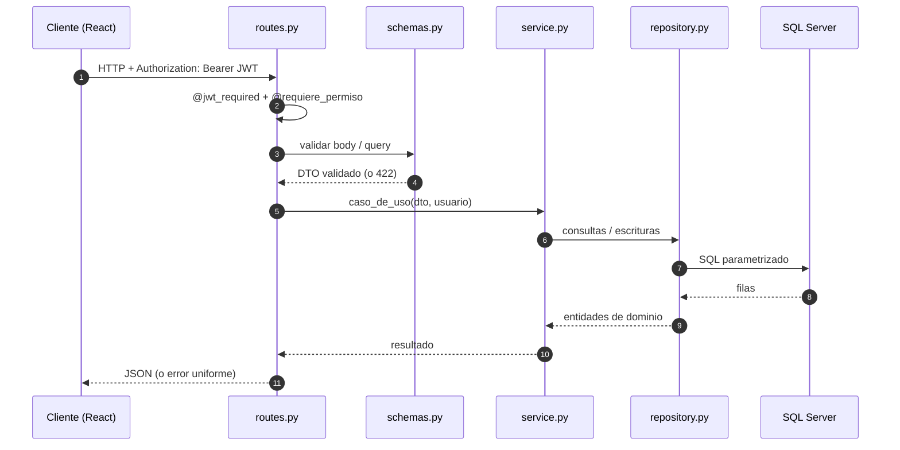
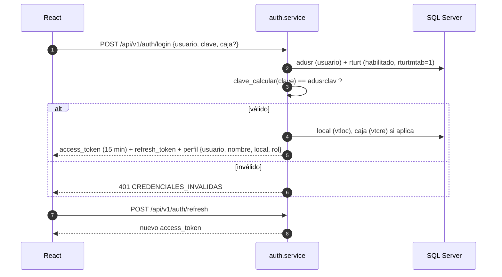
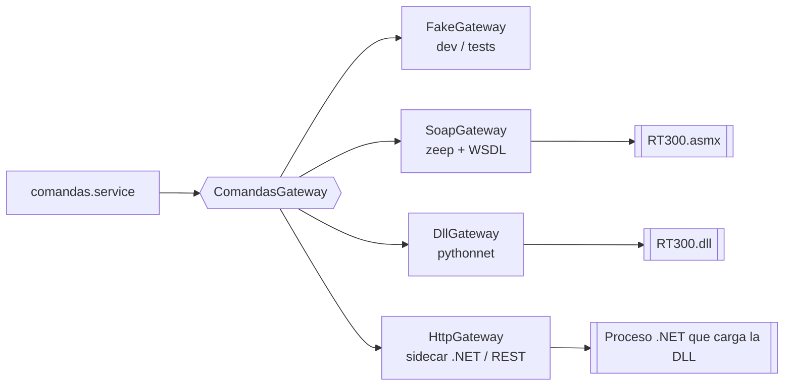
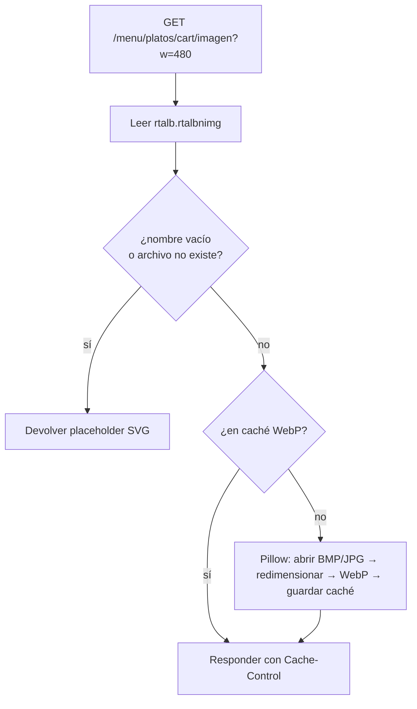

# Backend Flask — Diseño y flujos

> Complementa [00-arquitectura-general.md](00-arquitectura-general.md).
> Stack: **Python 3.13 · Flask · Pydantic v2 (flask-openapi3) · SQLAlchemy 2 + pyodbc · flask-jwt-extended · zeep (SOAP) · pytest**.

---

## 1. Principios

1. **La BD no se altera.** Se mapean solo las ~30 tablas que usa RT-300, sin crear ni modificar esquema. Tablas nuevas (si algún día se necesitan) irían con Alembic y prefijo propio.
2. **Monolito modular.** Un paquete por dominio. Cada uno se puede probar solo y, si hiciera falta, extraer después.
3. **Capas estrictas:** `routes → services → repositories / integrations`.
4. **Todo SQL parametrizado** y solo dentro de `repository.py`.
5. **Integraciones externas detrás de una interfaz** (`ComandasGateway`), nunca llamadas directas desde el negocio.
6. **Errores de dominio**, no excepciones genéricas: un handler global los traduce a JSON uniforme.

---

## 2. Estructura de carpetas

```
api/
├── app/
│   ├── __init__.py              # create_app(config) — application factory
│   ├── config.py                # Dev / Test / Prod, todo desde variables de entorno
│   ├── extensions.py            # engine SQLAlchemy, JWT, CORS, limiter
│   ├── core/
│   │   ├── db.py                # engine, session scope, unit of work
│   │   ├── errors.py            # DomainError, NotFound, Conflict, GatewayError...
│   │   ├── error_handlers.py    # traduce errores a {error:{code,message,request_id}}
│   │   ├── security.py          # JWT, decoradores @requiere_rol / @requiere_permiso
│   │   ├── legacy_password.py   # clave_calcular() portada (solo verificación)
│   │   ├── text.py              # normalización de texto / eñes / ISO-8859-1 ↔ UTF-8
│   │   └── logging.py           # logs JSON + request_id
│   ├── modules/
│   │   ├── auth/       routes.py · schemas.py · service.py · repository.py
│   │   ├── salon/      (mesas, áreas, folios, cuentas de mesa)
│   │   ├── clientes/
│   │   ├── menu/       (+ images.py: sirve/convierte imágenes de platos)
│   │   ├── comandas/
│   │   └── cuentas/    (estado de cuenta)
│   └── integrations/
│       └── comandas/
│           ├── base.py          # interfaz ComandasGateway + DTOs
│           ├── soap_gateway.py  # zeep sobre WSDL (igual al actual)
│           ├── dll_gateway.py   # pythonnet (si el servicio es una DLL .NET)
│           ├── http_gateway.py  # futuro: sidecar/REST
│           ├── fake_gateway.py  # pruebas y desarrollo sin servicio
│           └── factory.py       # elige implementación por GATEWAY_MODE
├── tests/
│   ├── unit/                    # services con repositories falsos
│   └── integration/             # repositories contra SQL Server Docker
├── .env.example
├── requirements.txt
├── wsgi.py
└── Dockerfile
```

Cada módulo sigue el mismo molde:

| Archivo | Responsabilidad | Prohibido |
|---|---|---|
| `routes.py` | Blueprint, parsea request, llama al service, devuelve JSON | SQL, reglas de negocio |
| `schemas.py` | Modelos Pydantic de entrada/salida (la API en términos de negocio) | Lógica |
| `service.py` | Casos de uso (`OcuparMesa`, `GuardarComanda`…), transacciones | Flask, SQL crudo |
| `repository.py` | Consultas SQL a tablas legacy → objetos de dominio | Reglas de negocio |

---

## 3. Flujo de una petición



Formato de error uniforme:

```json
{ "error": { "code": "MESA_OCUPADA", "message": "La mesa 12 ya está ocupada.", "request_id": "b1f4…" } }
```

---

## 4. Autenticación y autorización



- **El JWT lleva:** `usuario`, `local (cloc)`, `almacén (calm)`, `rol`. **Nunca la clave.**
- Roles previstos: `garzon`, `cajero`, `admin`. Se derivan de `rturt` / datos de `adusr` (por confirmar).
- Acciones sensibles (eliminar comanda) exigen además **usuario autorizador + clave** en el cuerpo, como hoy (`uaut`, `cont`).
- Rate limiting en `/auth/login`.

---

## 5. API REST v1 (mapa legacy → nuevo)

Prefijo `/api/v1`. Reemplaza las funciones `sys_func` del PHP.

### auth
| Método y ruta | Reemplaza |
|---|---|
| `GET  /auth/usuarios` | `f5101_buscar_usuarios_adusr/rturt` (lista de la pantalla de login) |
| `POST /auth/login` | `f5000_iniciar_session` |
| `POST /auth/refresh` · `POST /auth/logout` | `inc/logout.php` |

### salon (RT300a)
| Método y ruta | Reemplaza |
|---|---|
| `GET  /salon/parametros` | `f4100_cargar_parametros_iniciales_rt300a` (local, áreas, meseros) |
| `GET  /salon/areas` | `cargar_rtaco` |
| `GET  /salon/areas/{area}/mesas` | `f4100_cargar_mesas_area_consumo_rt300a` |
| `GET  /salon/mesas/{mesa}` | `click_mesa`, `f5100_buscar_datos_mesa` |
| `POST /salon/mesas/{mesa}/ocupar` | `f1000_ocuparmesa`, `insertar_folio`, `insertar_cuentas` |
| `POST /salon/mesas/{mesa}/habilitar` | `f1000_habilitar_mesa` |
| `PATCH /salon/mesas/{mesa}` | `f2000_modificar_mesa` |
| `GET  /salon/folios/{folio}/resumen` | `mostrar_resumen` |
| `GET  /salon/folios/{folio}/cuentas` | `mostrar_cuentas` |

### clientes (RT300b)
| Método y ruta | Reemplaza |
|---|---|
| `GET  /folios/{folio}/cuentas` | `f5000_buscar_cuentas_rt300b` |
| `GET  /clientes?codigo=&nombre=` | `f4100_buscar_cliente`, `f5000_buscar_avanzada_cliente` |
| `PUT  /folios/{folio}/cuentas/{cuenta}` | `f1000_actualizar_cuenta_rt300b` |

### menu (RT300c — carga)
| Método y ruta | Reemplaza |
|---|---|
| `GET  /menu/secciones` | `f4100_cargar_secciones_menu` (`rtsme`/`rtssm`) |
| `GET  /menu/secciones/{csme}/{cssm}/platos` | `f4102_cargar_platos` |
| `GET  /menu/platos/{cart}` | `datos_plato` |
| `GET  /menu/platos/{cart}/extras` | `f4101_cargar_extras`, `datos_plato_extra` |
| `GET  /menu/platos/{cart}/insumos` | `datos_modifica_insumo` (alternativos/quitados) |
| `GET  /menu/platos/{cart}/textos` · `.../subtextos` | `f4100_cargar_textos`, `f4101/2_cargar_subtextos` |
| `GET  /menu/centros-produccion` | `f4102/3_cargar_centros_produccion` |
| `GET  /menu/platos/{cart}/imagen` | *(nuevo)* ver §8 |

### comandas
| Método y ruta | Reemplaza |
|---|---|
| `POST /comandas` | `f1000_guardar_rt300c` + `f5944_invocar_web_service` |
| `POST /comandas/{ntmp}/reintentar` | *(nuevo)* reintenta el gateway sin reinsertar `rttmp` |
| `GET  /folios/{folio}/comandas` | `buscar_rtcoh_rtcda` (panel ADMIN) |
| `GET  /comandas/motivos-eliminacion` | `rtmtr` |
| `POST /comandas/eliminar` | `f1000_eliminar_comanda_rt300a` |
| `POST /comandas/reimprimir` | `f1000_reimprimir_comanda_rt300a` |

### cuentas (RT303)
| Método y ruta | Reemplaza |
|---|---|
| `GET  /folios/{folio}/cuentas/{cuenta}/estado` | `buscar_rtcoh_rtcda_rt303` |
| `POST /folios/{folio}/cuentas/{cuenta}/imprimir` | `f4000_imprimir_estado_cta_rt303` |

La documentación **OpenAPI/Swagger** se genera sola en `/api/docs` y de ella se puede generar el cliente TypeScript del frontend.

---

## 6. Capa de datos (SQL Server legacy)

- **SQLAlchemy 2 + pyodbc** con `ODBC Driver 18 for SQL Server`. Pool de conexiones configurado; **una conexión por request**, a diferencia del PHP actual, que compartía el enlace ODBC y fallaba al cerrarlo (ver README del proyecto actual §3).
- **Sin mapear las 425 tablas.** Solo las usadas. Se prefiere SQLAlchemy **Core** (`text()` con parámetros o `Table` reflejadas) a un ORM completo, porque el esquema es legacy (llaves compuestas, nombres de 5 letras, columnas `CHAR` con espacios).
- Los repositories devuelven **dataclasses de dominio** con nombres claros y `strip()` ya aplicado:

```python
# modules/salon/repository.py  (ejemplo de la idea)
def mesas_por_area(self, area: int) -> list[Mesa]:
    rows = self.db.execute(
        text("SELECT rtmsacmsa, rtmsaestd, ... FROM rtmsa WHERE rtmsacaco = :area"),
        {"area": area},
    )
    return [Mesa(codigo=r.rtmsacmsa.strip(), estado=EstadoMesa(r.rtmsaestd), ...) for r in rows]
```

- **Compatibilidad 100 (SQL Server 2008):** no hay `OFFSET/FETCH`, `IIF` ni `CONCAT`. Paginación con `ROW_NUMBER()`. Las consultas nuevas deben respetarlo.
- **Texto / eñes:** el driver 18 en Linux ya entrega UTF-8; centralizar en `core/text.py` la conversión y probar escritura de `ñ` y acentos antes de grabar datos reales (punto pendiente nº 3 del README actual).
- **Transacciones:** una por caso de uso (`with uow:`), con `commit` explícito y `rollback` ante cualquier `DomainError`.
- **Numeración:** `NroSerial` (tabla `rtsrl`) se porta como `SerialRepository.siguiente(tabla, campo)` con bloqueo adecuado para evitar duplicados con concurrencia.
- **Regla del proyecto:** ningún `INSERT/UPDATE/DELETE/DDL` fuera de los casos de uso aprobados (ocupar/habilitar mesa, actualizar cuenta, `rttmp` al guardar comanda). Los de solo lectura son el punto de partida.

---

## 7. Integración con el servicio de comandas (Gateway)

### 7.1 Interfaz

```python
# integrations/comandas/base.py
class ComandasGateway(Protocol):
    def alta_comanda(self, req: AltaComandaReq) -> ResultadoGateway: ...
    def eliminar_comanda(self, req: EliminarComandaReq) -> ResultadoGateway: ...
    def reimprimir_comanda(self, req: ReimprimirComandaReq) -> ResultadoGateway: ...
    def estado_cuenta(self, req: EstadoCuentaReq) -> ResultadoGateway: ...   # éxito = 100

@dataclass
class ResultadoGateway:
    ok: bool
    codigo: str | int | None
    mensaje: str
    crudo: Any = None      # respuesta original, para logs
```

Los DTO (`AltaComandaReq`, …) tienen exactamente los parámetros listados en el doc general §6 (`ntra, nfol, ncta, cmon, glos, cloc, usrn, pass`…).

### 7.2 Implementaciones y cómo se elige



`GATEWAY_MODE=fake | soap | dll | http` en `.env`. El negocio **no cambia**.

### 7.3 Si el servicio es una DLL

Python no puede cargar una DLL .NET como una librería nativa. Opciones:

| Opción | Cómo | Pros | Contras |
|---|---|---|---|
| **A. `pythonnet` (`DllGateway`)** | `import clr; clr.AddReference("RT300")` dentro del proceso Flask | Sin servicio extra; misma lógica | Solo **Windows** + runtime .NET Framework/Core instalado; arquitectura 32/64 bits debe coincidir; no sirve en contenedor Linux |
| **B. Sidecar .NET (`HttpGateway`)** | Mini API .NET que carga la DLL y expone HTTP/JSON | Aísla la DLL; Flask puede ir en Docker/Linux; se reemplaza fácil | Un proceso más que mantener |
| **C. Mantener SOAP (`SoapGateway`)** | `zeep` con la URL del WSDL, igual que el PHP | Cero cambios en el servicio | Requiere el `.asmx` publicado (hoy da 404) |

**Recomendación:** definir el gateway ya (hecho) y empezar con `FakeGateway`. Cuando se confirme el tipo de DLL: si el servidor es Windows → **A** para ir rápido; si se quiere Docker/Linux → **B**.

### 7.4 Credenciales hacia el servicio
El PHP envía `usrn` + `pass` (la clave queda en sesión). Con JWT no guardamos la clave. Opciones: (a) el servicio acepta solo `usrn` + credencial técnica del sistema (variable de entorno); (b) se guarda la clave cifrada en la sesión del servidor. **Decisión pendiente** (ver doc general §8).

---

## 8. Imágenes de platos



- Carpeta de origen configurable: `IMAGENES_DIR` (hoy `img/Restaurantes/`, mayormente `.bmp`).
- El frontend usa siempre ese endpoint y muestra el placeholder si responde 404/placeholder.
- No se modifica ninguna tabla: el nombre del archivo ya existe en `rtalb.rtalbnimg`.

---

## 9. Configuración (`.env`)

```
FLASK_ENV=development
SECRET_KEY=...
JWT_SECRET_KEY=...
JWT_ACCESS_MINUTES=15
CORS_ORIGINS=http://localhost:5173

DB_DRIVER=ODBC Driver 18 for SQL Server
DB_HOST=localhost
DB_PORT=1433
DB_NAME=tbpos_new
DB_USER=prueba
DB_PASSWORD=prueba
DB_TRUST_CERT=yes

GATEWAY_MODE=fake               # fake | soap | dll | http
GATEWAY_WSDL_URL=http://192.168.0.2/RT300WS/RT300.asmx?WSDL
GATEWAY_DLL_PATH=
GATEWAY_HTTP_URL=
GATEWAY_TIMEOUT_SECONDS=30

IMAGENES_DIR=D:/.../img/Restaurantes
IMAGENES_CACHE_DIR=./.cache/img
```

Las credenciales `prueba/prueba` son solo para el contenedor de pruebas local.

---

## 10. Estrategia de pruebas

| Nivel | Qué prueba | Cómo |
|---|---|---|
| Unitarias | `services` con repositories y gateway falsos | `pytest`, sin BD |
| Integración | `repositories` contra la BD de Docker (**solo lectura** salvo tests marcados) | `pytest -m integration` |
| Contrato | Que `SoapGateway`/`DllGateway` cumplen la interfaz | mismos tests parametrizados sobre las implementaciones |
| API | Rutas, permisos, errores | `flask test client` |
| Regresión vs PHP | Mismas entradas → mismo resultado que el sistema actual | comparar respuestas de menú, mesas y resúmenes |

---

## 11. Cómo agregar una función nueva (ej. «Reservas»)

1. Crear `app/modules/reservas/{routes,schemas,service,repository}.py`.
2. Registrar el blueprint en `create_app()` (una línea).
3. Agregar permisos en `core/security.py`.
4. Pruebas en `tests/unit/reservas` y `tests/integration/reservas`.
5. Frontend: crear `src/features/reservas/` (ver [02-frontend-react.md](02-frontend-react.md)).

No se toca ningún módulo existente.
