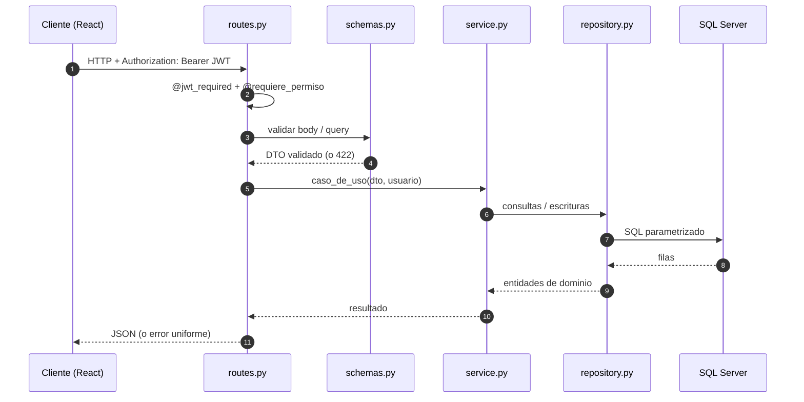
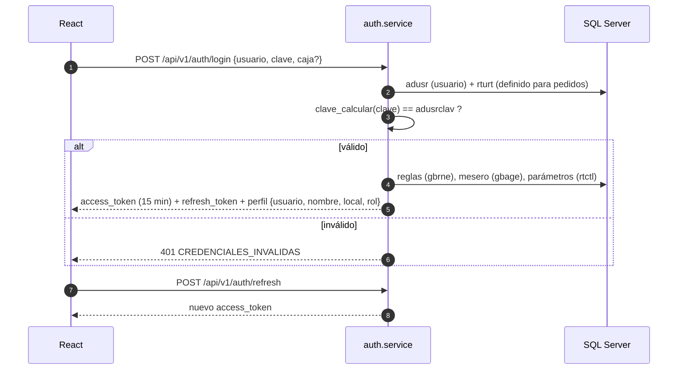
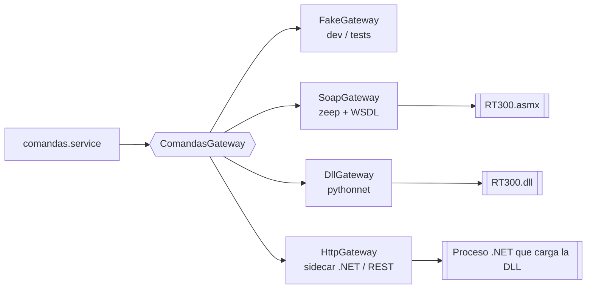
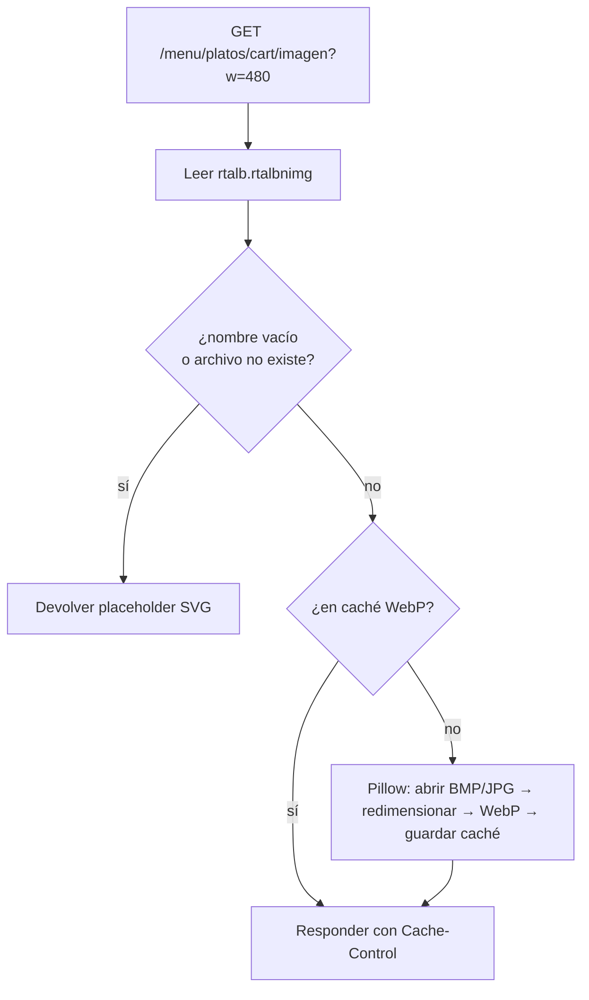

# Backend Flask — Diseño y flujos

> Complementa [00-arquitectura-general.md](00-arquitectura-general.md).
> Stack: **Python 3.13 · Flask · Pydantic v2 (flask-openapi3) · SQLAlchemy 2 + pyodbc · flask-jwt-extended · zeep (SOAP) · pytest**.

---

## 1. Principios

1. **La BD no se altera.** Se mapean solo las ~30 tablas que usa RT-300, sin crear ni modificar esquema. Tablas nuevas (si algún día se necesitan) irían con Alembic y prefijo propio.
2. **Monolito modular.** Un paquete por dominio. Cada uno se puede probar solo y, si hiciera falta, extraer después.
3. **Capas estrictas:** `routes → services → repositories / integrations`.
4. **Todo SQL parametrizado** y solo dentro de `repository.py`.
5. **Integraciones externas detrás de una interfaz** (`ComandasGateway`), nunca llamadas directas desde el negocio.
6. **Errores de dominio**, no excepciones genéricas: un handler global los traduce a JSON uniforme.

---

## 2. Estructura de carpetas

```
rt300-backend/
├── app/
│   ├── __init__.py              # create_app(): config, extensiones, blueprints, /health
│   ├── composition.py           # COMPOSITION ROOT: único sitio que une servicios con implementaciones concretas
│   ├── config.py                # todo desde variables de entorno (valida secretos en producción)
│   ├── extensions.py            # JWT, CORS, limiter, lista de tokens revocados
│   ├── domain/                  # núcleo sin Flask ni SQL
│   │   ├── usuario.py           # Usuario autenticado (claims del JWT)
│   │   ├── mesa.py              # Mesa + constantes con nombre (ESTM_OCUPADA, ESTC_LIQUIDADA…)
│   │   └── uow.py               # Protocol UnitOfWork (`with uow:` = commit / rollback)
│   ├── core/
│   │   ├── db.py                # engine, UNA conexión por request, SqlUnitOfWork
│   │   ├── sql.py               # helpers parametrizados, SqlRepository base, serial atómico
│   │   ├── repos_compartidos.py # consultas usadas por varios módulos (MesaQueries)
│   │   ├── respuesta.py         # Salida (base de los modelos de salida) y responder(modelo, datos)
│   │   ├── salidas_comunes.py   # modelos de salida compartidos (ConsumoOut, MensajeOut, SaludOut)
│   │   ├── acceso.py            # exigir_local(): control de acceso por local
│   │   ├── errors.py · error_handlers.py · logging.py (JSON + request_id)
│   │   ├── security.py          # @autenticado / @requiere_rol, usuario_actual()
│   │   ├── legacy_password.py   # clave_calcular() portada (SOLO verificación)
│   │   └── text.py              # normalización de CHAR legacy
│   ├── modules/                 # un paquete por dominio, todos con el mismo molde
│   │   └── auth/ salon/ clientes/ menu/ comandas/ cuentas/
│   │       ├── ports.py         # dataclasses de dominio + Protocol del repositorio (el contrato)
│   │       ├── repository.py    # implementación SQL (único sitio con SQL)
│   │       ├── service.py       # casos de uso: reciben puertos por constructor
│   │       ├── schemas.py       # Pydantic: modelos de ENTRADA (…In) y de SALIDA (…Out, el contrato con el front)
│   │       ├── tokens.py        # (solo auth) emisión, renovación y revocación de JWT
│   │       └── routes.py        # Blueprint: parsea, pide el servicio a composition, responde
│   │       (comandas/ se divide en guardar.py y administrar.py)
│   └── integrations/comandas/
│       ├── base.py              # DTOs + interfaces pequeñas (Alta / Gestion / EstadoCuenta)
│       ├── seguro.py            # invocar(): cualquier fallo → GatewayError
│       ├── factory.py           # REGISTRO por GATEWAY_MODE
│       └── fake_gateway.py · soap_gateway.py · http_gateway.py · dll_gateway.py
├── tests/unit/                  # services con repositorios y gateway falsos (sin BD)
├── Dockerfile · requirements.txt · wsgi.py · .env.example
```

Molde de cada módulo:

| Archivo | Responsabilidad | Prohibido |
|---|---|---|
| `routes.py` | Blueprint: valida la entrada, llama al service y responde con `responder(ModeloOut, datos)` | SQL, reglas de negocio, armar tokens o diccionarios de respuesta |
| `schemas.py` | Modelos Pydantic de **entrada** (`…In`) y de **salida** (`…Out`) | Lógica |
| `service.py` | Casos de uso; transacciones con `with self._uow:` | Flask, SQL, importar repositorios concretos |
| `ports.py` | Contratos (Protocol) y dataclasses de dominio | Implementación |
| `repository.py` | SQL parametrizado → dataclasses/dicts | Reglas de negocio |

**Respuestas tipadas.** Cada endpoint declara un modelo de salida y responde con `responder(ModeloOut, datos)` (`core/respuesta.py`):
solo salen los campos declarados (una columna nueva o personal de la base legacy no se filtra por accidente), se conservan exactamente las
claves que entrega el servicio (sin `null` inventados) y un dato con tipo inválido falla en el servidor en vez de llegar mal al front.
Los bloques que son filas legacy completas a propósito (`gbpmt`, `gbrne`, `local`, `moneda`…) se declaran `dict[str, Any]`.

**Dependencias (SOLID):** `routes → composition → services → ports ← repositories`. Los servicios dependen de
*abstracciones* (`SalonRepo`, `UnitOfWork`, `AltaComandaGateway`…); `composition.py` decide qué implementación
concreta recibe cada uno. Un módulo nunca importa el repositorio de otro.

---

## 3. Flujo de una petición



Formato de error uniforme:

```json
{ "error": { "code": "MESA_OCUPADA", "message": "La mesa 12 ya está ocupada.", "request_id": "b1f4…" } }
```

---

## 4. Autenticación y autorización



- **El JWT lleva:** `usuario`, `local (cloc)`, `almacén (calm)`, `rol`. **Nunca la clave.**
- Roles previstos: `garzon`, `cajero`, `admin`. Se derivan de `rturt` / datos de `adusr` (por confirmar).
- Acciones sensibles (eliminar comanda) exigen además **usuario autorizador + clave** en el cuerpo, como hoy (`uaut`, `cont`); el backend la **verifica antes de escribir** en `rttmp`.
- Usuario inexistente, sin acceso a pedidos, sin clave o clave errónea devuelven **el mismo mensaje** (no se revela qué usuarios existen). Los motivos de configuración (deshabilitado, sin local…) solo se informan tras una clave correcta.
- `POST /auth/logout` **revoca** el token de acceso y, si se envía `refresh_token`, también el de refresco (lista en memoria; con varias instancias mover a Redis).
- **Acceso por local:** un usuario solo opera mesas, folios y comandas de **su** local (`cloc` del token). Mesa → local por su área (`rtmsa.rtmsacaco → rtaco.rtacocloc`); folio → `rtfol.rtfolcloc`. Lo de otro local responde `403 OTRO_LOCAL`. La regla vive en `core/acceso.py` y la aplican los services, no las rutas.
- Códigos de error de auth que consume el front: `CREDENCIALES_INVALIDAS` (401), `DEMASIADOS_INTENTOS` (429), `TOKEN_EXPIRADO` y `TOKEN_REVOCADO` (401), más los de configuración del usuario (`USUARIO_DESHABILITADO`, `SIN_LOCAL`, `SIN_MESERO`, `SIN_ALMACEN`…), que solo se informan tras una clave correcta. Los errores HTTP genéricos (400, 404, 405, 413, 429) llevan mensaje en español.
- Rate limiting: `/auth/login` 10/min, `/auth/usuarios` 30/min, `/comandas/eliminar` 20/min. Cuerpo máximo 1 MB.

---

## 5. API REST v1 (mapa legacy → nuevo)

Prefijo `/api/v1`. Todo requiere `Authorization: Bearer <JWT>` salvo `/health`, `/auth/usuarios`, `/auth/login` y la imagen del plato.
Hay una colección lista para importar en Bruno/Postman: [`docs/bruno/RT300.postman_collection.json`](bruno/RT300.postman_collection.json).

### auth
| Método y ruta | Reemplaza |
|---|---|
| `GET  /auth/usuarios` | lista de la pantalla de login (30/min) |
| `POST /auth/login` | `f5000_iniciar_session` (10/min por IP). Responde `{ access_token, refresh_token, perfil }`; `perfil` = `usuario, nombre, local` (nombre del local, texto), `rol`, y `cloc, calm, cmon, nreg` |
| `POST /auth/refresh` · `POST /auth/logout` · `GET /auth/me` | `inc/logout.php` (el logout revoca el token) |

### salon (RT300a)
| Método y ruta | Reemplaza |
|---|---|
| `GET  /salon/parametros` | `f4100_cargar_parametros_iniciales_rt300a` |
| `GET  /salon/areas/{caco}/mesas` | `f4100_cargar_mesas_area_consumo_rt300a` |
| `GET  /salon/mesas/{mesa}` | `click_mesa_rt300a` |
| `POST /salon/mesas/{mesa}/ocupar` | `f1000_ocuparmesa_rt300a` (toma atómica, 409 si ya está ocupada) |
| `POST /salon/mesas/{mesa}/habilitar` | `f1000_habilitar_mesa_rt300a` |
| `GET  /salon/folios/{nfol}/modificacion` · `PATCH /salon/folios/{nfol}` | `f5100_buscar_datos_mesa` · `f2000_modificar_mesa` |
| `GET  /salon/folios/{nfol}/resumen` · `/cuentas` | `mostrar_resumen` · `mostrar_cuentas` |

### clientes (RT300b)
| Método y ruta | Reemplaza |
|---|---|
| `GET  /folios/{nfol}/cuentas` | `f5000_buscar_cuentas_rt300b` |
| `GET  /clientes?codigo=&nombre=` | `f4100_buscar_cliente`, `f5000_buscar_avanzada_cliente`. Por `nombre`: `{ clientes: [{ codigo, nombre }] }`. Por `codigo`: `{ clientes: [{ codigo, nombre, nruc, ndid, lpre }] }` (`lpre` = lista de precio del cliente; antes devolvía la fila completa de `gbage`, con datos personales) |
| `PUT  /folios/{nfol}/cuentas/{ncta}` | `f1000_actualizar_cuenta_rt300b` |

### menu (RT300c — carga)
| Método y ruta | Reemplaza |
|---|---|
| `GET  /menu/secciones` | `f4100_cargar_secciones_menu` |
| `GET  /menu/secciones/{csme}/{cssm}/platos` | `f4102_cargar_platos` |
| `GET  /menu/secciones/{csme}/{cssm}/extras` | `f4101_cargar_extras` |
| `GET  /menu/platos/{cart}?tent&entg&lpre&cpxc` | `datos_plato` (precio, insumos, centro de producción) |
| `GET  /menu/extras/{cart}?pvta&cmop&cpxc` | `datos_plato_extra` |
| `GET  /menu/insumos/{cins}/alternativos` | `Obtener_Alternativos` |
| `GET  /menu/textos` · `/menu/subtextos?cart&pref` | `f4100_cargar_textos`, `f4102_cargar_subtextos` |
| `GET  /menu/platos/{cart}/centros-produccion` | `f4102_cargar_centros_produccion` |
| `GET  /menu/platos/{cart}/imagen?w=` | *(nuevo)* pública, anchos fijos 160…960, WebP en caché |

### comandas
| Método y ruta | Reemplaza |
|---|---|
| `POST /comandas` | `f1000_guardar_rt300c` + `f5944_invocar_web_service` |
| `POST /comandas/{ntmp}/reintentar` | *(nuevo)* reinvoca al servicio sin reinsertar `rttmp` |
| `GET  /folios/{nfol}/comandas?mesa=` | `aministrar_comandas_rt300a` (panel ADMIN) |
| `GET  /comandas/motivos-eliminacion` | `rtmtr` |
| `POST /comandas/eliminar` | `f1000_eliminar_comanda_rt300a` (el backend valida la clave del autorizador) |
| `POST /comandas/reimprimir` | `f1000_reimprimir_comanda_rt300a` |

### cuentas (RT303)
| Método y ruta | Reemplaza |
|---|---|
| `GET  /folios/{nfol}/cuentas-abiertas` | `f5000_buscar_cuentas_rt303` |
| `GET  /folios/{nfol}/cuentas/{ncta}/estado?mesa=` | `buscar_rtcoh_rtcda_rt303` |
| `POST /folios/{nfol}/cuentas/{ncta}/imprimir` | `f4000_imprimir_estado_cta_rt303` |

`datos_modifica_insumo_rt300c` del PHP **no se porta**: está marcada «Eliminar» en el código antiguo y el JS no la llama.

---

## 6. Capa de datos (SQL Server legacy)

- **SQLAlchemy 2 + pyodbc** con `ODBC Driver 18 for SQL Server`. Pool de conexiones configurado; **una conexión por request**, a diferencia del PHP actual, que compartía el enlace ODBC y fallaba al cerrarlo (ver README del proyecto actual §3).
- **Sin mapear las 425 tablas.** Solo las usadas. Se prefiere SQLAlchemy **Core** (`text()` con parámetros o `Table` reflejadas) a un ORM completo, porque el esquema es legacy (llaves compuestas, nombres de 5 letras, columnas `CHAR` con espacios).
- Los repositories devuelven **dataclasses de dominio** con nombres claros y `strip()` ya aplicado:

```python
# modules/salon/repository.py  (ejemplo de la idea)
def mesas_por_area(self, area: int) -> list[Mesa]:
    rows = self.db.execute(
        text("SELECT rtmsacmsa, rtmsaestd, ... FROM rtmsa WHERE rtmsacaco = :area"),
        {"area": area},
    )
    return [Mesa(codigo=r.rtmsacmsa.strip(), estado=EstadoMesa(r.rtmsaestd), ...) for r in rows]
```

- **Compatibilidad 100 (SQL Server 2008):** no hay `OFFSET/FETCH`, `IIF` ni `CONCAT`. Paginación con `ROW_NUMBER()`. Las consultas nuevas deben respetarlo.
- **Texto / eñes:** el driver 18 en Linux ya entrega UTF-8; centralizar en `core/text.py` la conversión y probar escritura de `ñ` y acentos antes de grabar datos reales (punto pendiente nº 3 del README actual).
- **Transacciones:** una por caso de uso (`with uow:`), con `commit` explícito y `rollback` ante cualquier `DomainError`.
- **Numeración:** `NroSerial` (tabla `rtsrl`) se porta como `SerialRepository.siguiente(tabla, campo)` con bloqueo adecuado para evitar duplicados con concurrencia.
- **Regla del proyecto:** ningún `INSERT/UPDATE/DELETE/DDL` fuera de los casos de uso aprobados (ocupar/habilitar mesa, actualizar cuenta, `rttmp` al guardar comanda). Los de solo lectura son el punto de partida.

---

## 7. Integración con el servicio de comandas (Gateway)

### 7.1 Interfaz

```python
# integrations/comandas/base.py  — interfaces pequeñas: cada caso de uso depende solo de lo que usa
class AltaComandaGateway(Protocol):
    def alta_comanda(self, req: AltaComandaReq) -> ResultadoGateway: ...          # éxito = entero > 0
class GestionComandaGateway(Protocol):
    def eliminar_comanda(self, req: EliminarComandaReq) -> ResultadoGateway: ...
    def reimprimir_comanda(self, req: ReimprimirComandaReq) -> ResultadoGateway: ...
class EstadoCuentaGateway(Protocol):
    def estado_cuenta(self, req: EstadoCuentaReq) -> ResultadoGateway: ...        # éxito = 100
class ComandasGateway(AltaComandaGateway, GestionComandaGateway, EstadoCuentaGateway, Protocol): ...

@dataclass
class ResultadoGateway:
    ok: bool
    codigo: str | int | None
    mensaje: str
    crudo: Any = None      # respuesta original, para logs
```

Los DTO (`AltaComandaReq`, …) tienen exactamente los parámetros listados en el doc general §6 (`ntra, nfol, ncta, cmon, glos, cloc, usrn, pass`…).

### 7.2 Implementaciones y cómo se elige



`GATEWAY_MODE=fake | soap | dll | http` en `.env`. El negocio **no cambia**.

### 7.3 Cómo se conecta hoy el sistema antiguo (evidencia del código)

- `inc/config.php`: `SYS_WEBSERVICE_DIR = http://192.168.0.2/RT300WS/RT300.asmx` → **SOAP sobre HTTP** hacia un servidor de la red del club (el mismo `192.168.0.2` de la BD, `SERVERPOS`). El PHP hace `new SoapClient(url."?WSDL")` y llama a 4 operaciones (§6 del doc general).
- Ese servicio **no está en el repositorio antiguo**. En la copia de pruebas la ruta responde 404, y desde el entorno de desarrollo `192.168.0.2` no responde, así que el gateway real **no se ha podido probar**.
- Una DLL .NET detrás de un `.asmx` es lo habitual: la DLL no la carga PHP ni Flask, la carga IIS. Por eso el contrato con nosotros sigue siendo una URL, no un archivo.

**Consecuencia de diseño:** el modo `soap` solo necesita `GATEWAY_WSDL_URL`. El modo `dll` (pythonnet) únicamente serviría si el backend
corriera **en Windows, fuera de Docker**, con el runtime .NET y la misma arquitectura (32/64 bits); un contenedor Linux no puede cargar
una DLL de Windows. Si algún día se publica solo la DLL, la salida es un sidecar .NET detrás de `GATEWAY_MODE=http`.

Para verificar el servicio real, desde un equipo con acceso a la red del club:

```bash
curl -i "http://192.168.0.2/RT300WS/RT300.asmx?WSDL"      # debe devolver 200 y XML
```

y luego arrancar el backend con `GATEWAY_MODE=soap GATEWAY_WSDL_URL=...`. Las pruebas unitarias del gateway (`tests/unit/test_soap_gateway.py`)
ya verifican nombres de operación, parámetros y la interpretación de resultados con un cliente falso.

### 7.4 Credenciales hacia el servicio
El PHP envía `usrn` + `pass` (la clave del garzón, que quedaba en `$_SESSION['PASS']` y viajaba por HTTP). Con JWT no guardamos la clave.
Hoy `pass` sale de `GATEWAY_PASSWORD` (credencial técnica). **Decisión pendiente:** confirmar si el servicio valida la clave o solo el usuario.

---

## 8. Imágenes de platos



- Carpeta de origen configurable: `IMAGENES_DIR`. En este repo está copiada en `img/Restaurantes/` (163 archivos, 3,4 MB, tomados del proyecto antiguo) y el compose la monta de solo lectura en `/data/imagenes`.
- En la BD copiada solo 1 de 2155 platos tiene nombre de imagen (`TABLA MEXICANA.jpg`, que no existe en la carpeta), así que casi todo mostrará el placeholder.
- Solo se sirven anchos fijos (160, 240, 320, 480, 640, 960) y nunca se sale de la carpeta (anti path-traversal).
- El frontend usa siempre ese endpoint y muestra el placeholder si responde 404/placeholder.
- No se modifica ninguna tabla: el nombre del archivo ya existe en `rtalb.rtalbnimg`.

---

## 9. Configuración (`.env`)

```
FLASK_ENV=development           # production (por defecto) exige SECRET_KEY/JWT_SECRET_KEY propios
SECRET_KEY=...
JWT_SECRET_KEY=...
JWT_ACCESS_MINUTES=15
CORS_ORIGINS=http://localhost:5173

DB_DRIVER=ODBC Driver 18 for SQL Server
DB_HOST=localhost
DB_PORT=1433
DB_NAME=tbpos_new
DB_USER=prueba
DB_PASSWORD=prueba
DB_TRUST_CERT=yes

GATEWAY_MODE=fake               # fake | soap | dll | http
GATEWAY_WSDL_URL=http://192.168.0.2/RT300WS/RT300.asmx?WSDL
GATEWAY_DLL_PATH=
GATEWAY_HTTP_URL=
GATEWAY_PASSWORD=               # credencial técnica hacia el servicio (pendiente)
GATEWAY_TIMEOUT_SECONDS=30

ADMIN_USERS=                    # usuarios admin separados por coma (mapeo real de roles pendiente)
CAJERO_USERS=

IMAGENES_DIR=./img/Restaurantes
IMAGENES_CACHE_DIR=/data/cache
```

Las credenciales `prueba/prueba` son solo para el contenedor de pruebas local.

---

## 10. Estrategia de pruebas

| Nivel | Qué prueba | Cómo | Estado |
|---|---|---|---|
| Unitarias | `services` con repositorios, gateway y UoW falsos | `docker compose exec backend python -m pytest tests/unit` | **60 pruebas** (auth, tokens, respuestas tipadas, salon, clientes, comandas, acceso por local, gateway SOAP, helpers SQL, imágenes) |
| Integración | `repositories` contra la BD de Docker | `pytest -m integration` | pendiente |
| API | Rutas, permisos, errores | colección Bruno + `flask test client` | colección lista; tests pendientes |
| Regresión vs PHP | Mismas entradas → mismo resultado que el sistema actual | comparar menú, mesas y resúmenes | pendiente |

---

## 11. Cómo agregar una función nueva (ej. «Reservas»)

1. Crear `app/modules/reservas/{routes,schemas,service,repository}.py`.
2. Registrar el blueprint en `create_app()` (una línea).
3. Agregar permisos en `core/security.py`.
4. Pruebas en `tests/unit/reservas` y `tests/integration/reservas`.
5. Frontend: crear `src/features/reservas/` (ver [02-frontend-react.md](02-frontend-react.md)).

No se toca ningún módulo existente.

---

## 12. Problemas del sistema antiguo y cómo se evitan aquí

| Problema en el PHP | Causa | Solución en el nuevo backend |
|---|---|---|
| Datos **vacíos** / `odbc_close ... not a valid ODBC-Link` | `new data()` repetido: el driver devolvía el *mismo* enlace ODBC y el destructor de uno cerraba la conexión del otro | Una conexión del pool **por request** (`flask.g`), cerrada solo al terminar la petición. Los repositorios nunca la cierran; la unidad de trabajo solo hace commit/rollback. |
| Resultados consumidos tarde | `while ($rw = $odata->objeto($rs))` sobre cursores vivos | Los helpers (`rows`, `one`) **materializan** el resultado en listas antes de devolver; sobreviven aunque se cierre la conexión (`tests/unit/test_sql_helpers.py`). |
| Folios/transacciones duplicados | `NroSerial`: SELECT y luego UPDATE | `UPDATE … SET n = n + 1 OUTPUT deleted.n` en una sola sentencia. |
| Dos garzones ocupan la misma mesa | sin control de concurrencia | `UPDATE … WHERE estado = libre` y se mira cuántas filas cambió. |
| Una consulta por fila (N+1) | precios, insumos, cuentas, detalle de comandas | JOIN / `OUTER APPLY` / `IN (...)` por lote; INSERT de `rttmp` en lote. |
| Inyección SQL | SQL concatenado | Todo parametrizado; contadores con lista blanca. |
| Doble codificación UTF-8 | `ut000_json_encode` | El driver 18 ya entrega UTF-8; no se reconvierte. |

Verificación: 100 peticiones (25 simultáneas) mezclando salón, menú y estado de cuenta devolvieron todas datos completos, ninguna vacía.
