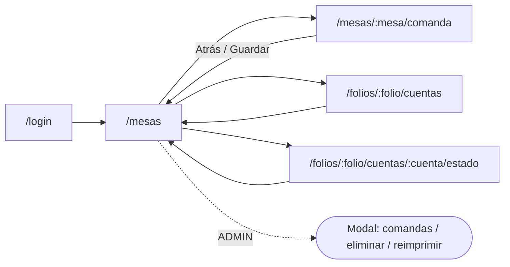
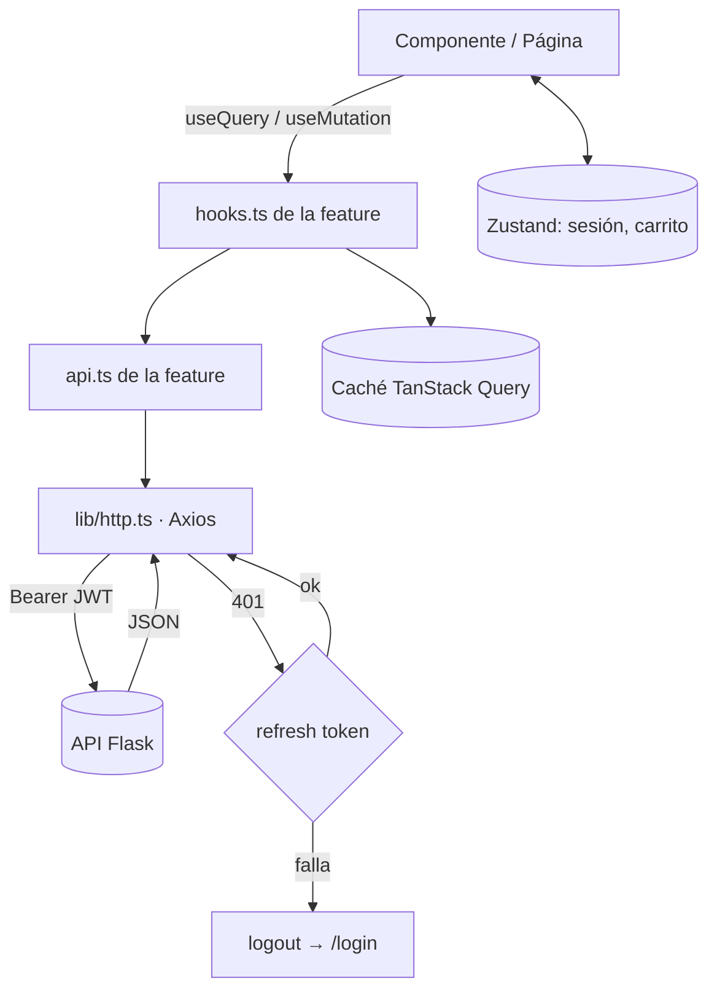
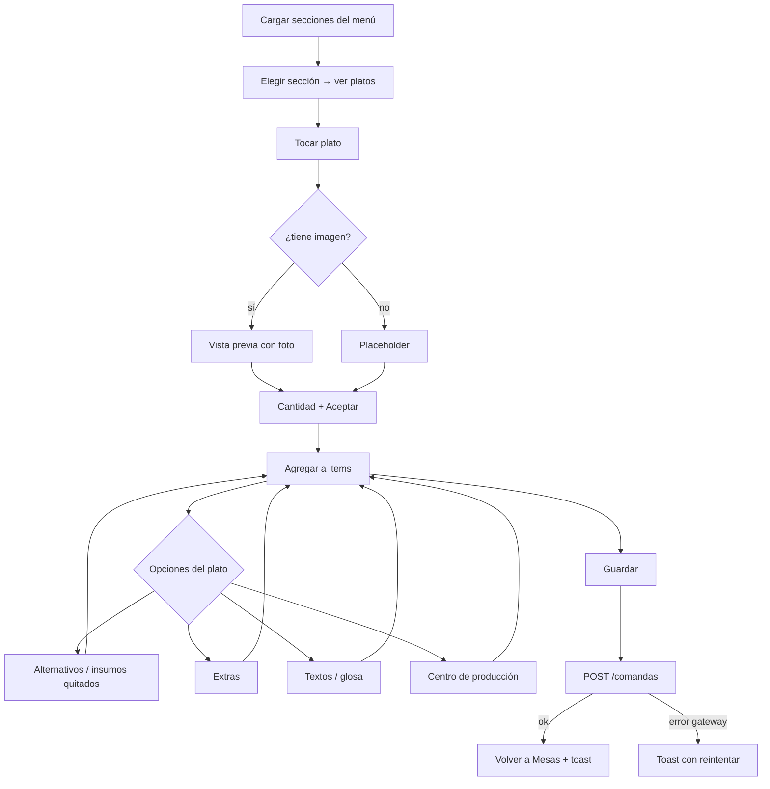

# Frontend React — Diseño y flujos

> Complementa [00-arquitectura-general.md](00-arquitectura-general.md) y [01-backend-flask.md](01-backend-flask.md).
> Stack: **React 19 · TypeScript · Vite · React Router · TanStack Query · Zustand · Axios · Tailwind CSS v4 · Zod · Vitest + Testing Library**.

---

## 1. Principios

1. **Organización por funcionalidad (feature-first)**, no por tipo de archivo.
2. **Estado del servidor ≠ estado de la UI.** El servidor se maneja con TanStack Query (caché, reintentos, loading/error); el estado local complejo (el carrito de la comanda) con Zustand.
3. **Sin lógica de negocio duplicada del backend.** El frontend valida UX; el backend valida de verdad.
4. **Tipos generados desde OpenAPI** del backend (`/api/docs`), para que front y back no se desincronicen.
5. **Táctil primero:** objetivos de 48 px, steppers grandes, funciona en tablet y celular.
6. **Tema por tokens** (claro/oscuro) tomado del diseño: nunca colores sueltos en los componentes.

---

## 2. Estructura de carpetas

```
web/
├── src/
│   ├── app/
│   │   ├── main.tsx · App.tsx
│   │   ├── router.tsx            # rutas + guards (RequireAuth, RequireRole)
│   │   ├── providers.tsx         # QueryClient, ThemeProvider, Toaster
│   │   └── layouts/              # AppLayout (topbar con logo + menú), AuthLayout
│   ├── features/
│   │   ├── auth/        pages/ components/ api.ts hooks.ts store.ts types.ts
│   │   ├── salon/       (MesasPage, MesaCard, OcuparMesaForm, ResumenMesa, AdminComandasModal)
│   │   ├── clientes/    (CuentasPage, BuscarClienteDialog)
│   │   ├── menu/        (SeccionesNav, PlatoCard, PlatoImagen, hooks de catálogo)
│   │   ├── comanda/     (ComandaPage, ItemsTable, ModalInsumos, ModalTextos, store del carrito)
│   │   └── cuentas/     (EstadoCuentaPage)
│   ├── shared/
│   │   ├── ui/          Button, Modal, Stepper, Table, Toast, Skeleton, EmptyState...
│   │   ├── hooks/       useDebounce, useMediaQuery, useOnlineStatus
│   │   └── utils/       formato de moneda, fechas
│   ├── lib/
│   │   ├── http.ts      # instancia Axios, interceptor JWT + refresh, mapeo de errores
│   │   ├── queryClient.ts
│   │   └── env.ts       # VITE_API_URL tipado
│   ├── api-types/       # tipos generados desde OpenAPI
│   └── styles/          # index.css con tokens del tema
├── public/              # logo, placeholder de plato
├── index.html
├── vite.config.ts
└── package.json
```

Cada `feature` es autocontenida: expone solo lo necesario desde su `index.ts`. **Una feature no importa de otra feature**; lo compartido va a `shared/`.

---

## 3. Mapa de pantallas y rutas



| Ruta | Pantalla | Feature | Protección |
|---|---|---|---|
| `/login` | Ingreso + chips de usuarios | auth | pública |
| `/mesas` | Mesas, ocupar/habilitar, resumen, ADMIN | salon | autenticado |
| `/mesas/:mesa/comanda` | Toma de pedido | comanda (+ menu) | autenticado |
| `/folios/:folio/cuentas` | Cuentas y clientes | clientes | autenticado |
| `/folios/:folio/cuentas/:cuenta/estado` | Estado de cuenta / imprimir | cuentas | autenticado |

El botón **ADMIN** (eliminar/reimprimir) solo se muestra con rol `admin`/`cajero` y siempre pide autorización en el backend.

### Estado de la conexión con el backend

| Pantalla | Estado |
|---|---|
| `/login` (auth) | **Conectada** a `rt300-backend` (`APP_MODE = 'production'`; el mockup se conserva en `src/simulados`). Contrato, errores y cambios: [`features/auth/README.md`](../rt300-frontend/src/features/auth/README.md) |
| `/pedidos` (mesas, panel, comanda), `/pedidos/cuentas/:mesa`, `/mesas` (Administración) | **Conectadas** al backend. Detalle, mapeos y reglas: [`features/pedidos/README.md`](../rt300-frontend/src/features/pedidos/README.md) |
| Estado de cuenta en pantalla, eliminar y reimprimir comandas (panel ADMIN) | Pendientes. El backend ya expone sus endpoints ([01 §5](01-backend-flask.md)) |

Reglas para conectar las siguientes pantallas:

- Las listas del backend vienen **envueltas** (`{ "mesas": [...] }`, `{ "platos": [...] }`…), nunca como arreglo suelto.
- Los errores son `{ error: { code, message, request_id } }`; `lib/http.ts` ya los convierte en `ErrorApi`.
- Las rutas por mesa o folio responden `403 OTRO_LOCAL` si pertenecen a otro local; el front no necesita filtrarlas.
- Al cerrar sesión llamar `/auth/logout` con la cabecera `X-Requested-With: rt300`: el backend revoca el acceso y la renovación (cookie) y la borra.
- Cada cambio relevante se registra en [`docs/CAMBIOS.md`](CAMBIOS.md) y en el README de la feature.

---

## 4. Flujo de datos



- **Sesión (Zustand + persistencia):** `accessToken` en memoria, el token de renovación **no está en JavaScript**: vive en una cookie HttpOnly; perfil (`usuario, local, rol`).
- **Interceptor 401:** intenta `refresh` una vez; si falla, cierra sesión y redirige.
- **Errores:** el backend devuelve `{error:{code,message,request_id}}`; `http.ts` lo convierte a un `ApiError` y la UI muestra un toast con el mensaje.

---

## 5. Pantalla Comanda (la más compleja)

### 5.1 Estado del carrito (Zustand)

```ts
interface ComandaState {
  folio: string; cuenta: number; moneda: string; glosa: string;
  items: ItemComanda[];           // plato, cantidad, precio, textos, centro de producción
  insumos: InsumoComanda[];       // quitados / alternativos / adicionados (rtcia)
  seleccionado?: ItemComanda;     // plato en edición
  agregarPlato(p: Plato, cant: number): void;
  quitarItem(id: string): void;
  aplicarAlternativo(...): void;
  total(): number;
  limpiar(): void;
}
```

Este store reemplaza las ~3.200 líneas de `RT300c.js` (variables globales `g_rtcia`, `g_item_select`…). Se **persiste en `sessionStorage`** para no perder la comanda si se recarga la página.

### 5.2 Flujo de la pantalla



### 5.3 Guardar con reintento
Si el backend responde `GATEWAY_UNAVAILABLE`, la UI **conserva el carrito** y ofrece «Reintentar» (`POST /comandas/{ntmp}/reintentar`), sin duplicar la comanda.

---

## 6. Imágenes de platos

- Componente único `PlatoImagen`: ``.
- `onError` → placeholder local (icono de cubiertos con color de superficie).
- Skeleton mientras carga. Nunca se rompe el layout si falta la foto (muchos platos no tienen).

---

## 7. Tema (claro / oscuro) y paleta

Los colores viven como **variables CSS** y Tailwind los consume como tokens (`bg-surface`, `text-muted`…). Cambiar de tema = cambiar la clase `dark` en `<html>` (por defecto sigue al sistema; el usuario puede forzarlo desde la barra superior y se recuerda).

| Token | Claro | Oscuro |
|---|---|---|
| `--bg` | `#F0F1F2` | `#00070F` |
| `--header` (cabecera / menú) | `#011526` | `#011526` |
| `--surface` | `#FFFFFF` | `#0A1F33` |
| `--surface-elevated` | `#FFFFFF` | `#0F2E44` |
| `--primary` | `#1B8EF2` | `#1B8EF2` |
| `--interactive` | `#0875CF` | `#7CC4FF` |
| `--text` | `#011526` | `#F2F6FA` |
| `--text-muted` | `#526479` | `#8FA3B6` |
| `--border` | `#DCE5EB` | `rgb(255 255 255 / 10%)` |
| `--success` | `#10B981` | `#10B981` |
| `--danger` | `#EF4444` | `#EF4444` |
| `--accent` (mesa ocupada, detalle) | `#F59F0B` al 48 % | `#F59F0B` al 48 % |

El logo de la cabecera (texto blanco sobre azul) está pensado para el fondo `#011526`.

---

## 8. Estados de UI obligatorios

Toda pantalla con datos debe contemplar: **cargando** (skeleton), **vacío** (EmptyState con acción), **error** (mensaje + reintentar) y **sin conexión** (aviso `useOnlineStatus`). Esto evita pantallas en blanco en la red del club.

---

## 9. Calidad

| Aspecto | Herramienta |
|---|---|
| Lint / formato | ESLint + Prettier |
| Tipos | `tsc --noEmit` en CI |
| Pruebas | Vitest + Testing Library (componentes y hooks); MSW para simular la API |
| E2E (opcional, fase 5) | Playwright sobre tablet viewport |
| Accesibilidad | Roles ARIA en modales, foco visible, contraste verificado en ambos temas |
| Variables | `VITE_API_URL` por entorno (`.env.development`, `.env.production`) |

PWA (opcional): instalable en la tablet, cache de estáticos y del menú para tolerar cortes breves de red. **Las escrituras (guardar comanda) no se encolan offline** en la primera versión, para no generar comandas duplicadas o desfasadas.

---

## 10. Cómo agregar una función nueva (ej. «Reservas»)

1. Crear `src/features/reservas/` con `pages/`, `components/`, `api.ts`, `hooks.ts`, `types.ts`.
2. Agregar la ruta en `app/router.tsx` con su guard de rol.
3. Agregar la entrada de menú en `AppLayout`.
4. Regenerar los tipos desde OpenAPI (`npm run gen:api`).
5. Pruebas con MSW.

No se modifica ninguna otra feature.
